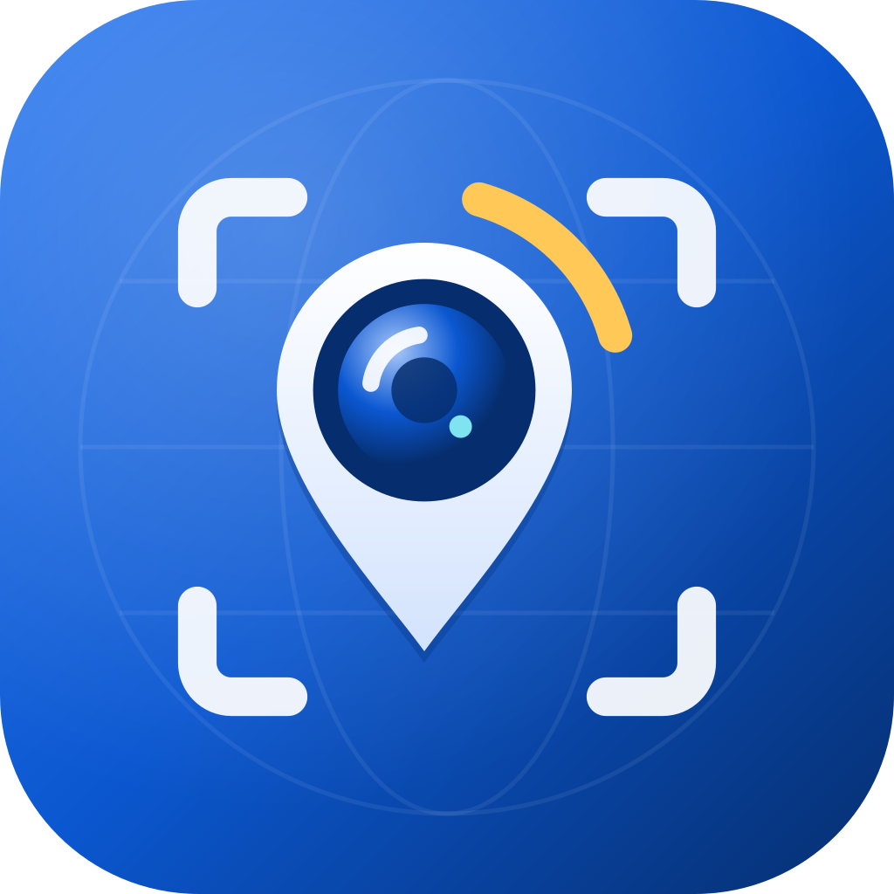

<p align="left"></p>

# AlphaGPS

**Write GPS location and time from your phone to a Sony Alpha camera over Bluetooth, and browse /
download photos from the camera over its Wi-Fi.**

AlphaGPS is a personal, open-source customization of [Saschl/alpha-gps](https://github.com/Saschl/alpha-gps).
It is not distributed through any app store — you build and install it yourself.

## Features

- **GPS location & time linking** — reads the phone's location (only with your permission) and
  writes it to your paired Sony camera over Bluetooth Low Energy, so photos are geotagged on the
  camera itself. Time and time-zone data is linked as well.
- **Photo browse & download over camera Wi-Fi** — connect to the camera's Wi-Fi and browse its
  photos:
  - date-grouped gallery (newest first) with lazy thumbnails;
  - multi-select and long-press drag range selection across days;
  - download strategy per batch: **JPG only** (skip RAW/HEIF) or **original files** (JPG + RAW).
- Companion-device based connection with a foreground service; optional “standby after the camera
  leaves” mode keeps the service ready to reconnect automatically.

English and Simplified Chinese only. Android only (see [iOS](#ios-target-is-disabled) below).

## Supported cameras

Sony cameras that support Bluetooth location linking with Imaging Edge Mobile or the Creators'
App should work. GPS geotagging has been confirmed (by upstream user reports) on these models:

- A1
- [A7 III](https://github.com/Saschl/alpha-gps/issues/260)
- [A7 IV](https://github.com/Saschl/alpha-gps/issues/301)
- [A7 V](https://github.com/Saschl/alpha-gps/issues/79)
- A7C II — confirmed by email.
- [A7R III](https://github.com/Saschl/alpha-gps/issues/95#issuecomment-5609520240) — enable
  **Location Info. Link** in the camera menu.
- [A7R V](https://github.com/Saschl/alpha-gps/issues/199)
- [A99 II](https://github.com/Saschl/alpha-gps/issues/294) — GPS confirmed; time correction and
  area adjustment were disabled in the report.
- [A6400](https://github.com/Saschl/alpha-gps/issues/195)
- [A6500](https://github.com/Saschl/alpha-gps/issues/301) — geotagging confirmed; other features
  are limited by the camera's capabilities.
- [A6700](https://github.com/Saschl/alpha-gps/issues/294)
- [ZV-1](https://github.com/Saschl/alpha-gps/issues/100)
- [ZV-E10](https://github.com/Saschl/alpha-gps/issues/67#issuecomment-3678222970)

These are user reports, not a guarantee. Wi-Fi-only models such as the
[A6000](https://github.com/Saschl/alpha-gps/issues/236) cannot use Bluetooth geotagging.
Reports are welcome — [share your results](https://github.com/mfreceiver/alpha-gps/issues).

## Requirements

- Android 12 (API 31) or newer, **arm64-only** (`arm64-v8a`; no 32-bit or x86 support).
- A Sony camera with Bluetooth location linking (see above) for GPS writing; camera Wi-Fi for
  photo browse/download.

## Build

Initialize the pinned libheif / libde265 source submodules first (native builds use these local
sources):

```bash
git submodule update --init --recursive
```

Then build the Android app:

```bash
./gradlew :app:assembleDebug
```

Other verification tasks are listed in [AGENTS.md](AGENTS.md). For releases (signed APKs, tags and
releases), see [`scripts/release_build.sh`](scripts/release_build.sh) — releasing is a manual,
confirmed step.

`scripts/release_build.sh --publish-only` publishes to the maintainer's primary repository first and,
only after that succeeds, to GitHub (`--no-github` skips it; `--publish-github-only` re-runs just the
GitHub step). The GitHub step pushes the release tag (plus the current branch only with
`--github-push-branch`), so the commit history reachable from it is publicly visible. The primary
repository address is kept in an untracked local file (see
[`scripts/release.local.env.example`](scripts/release.local.env.example)). The local GitHub remote
must resolve (fetch and push side, after `insteadOf`/`pushurl` rewriting) to exactly one URL,
`https://github.com/mfreceiver/alpha-gps.git`; anything else is rejected before any push. Exit codes:
`0` ok, `1` failure (usage/config/preflight/build/primary release; the GitHub step did not run),
`40` GitHub step failed — only in the dual-source modes (`--publish` / `--publish-only`) does this
mean the primary release already succeeded (it is not rolled back; fix the cause and re-run with
`--publish-github-only`); `--publish-github-only` never touches the primary repository.

This fork ships only English (`values/`) and Simplified Chinese (`values-zh-rCN/`) — do not add
other language directories.

## iOS target is disabled

This customization no longer ships iOS builds. The Gradle build does not register Apple targets;
the switch lives in `gradle.properties` (`alphagps.enableIos=false`). The remaining iOS sources
(`sharednew/src/iosMain`, `iosApp/`) are kept for potential future use; the Xcode project uses
English/`Base` regions only, and `iosApp/alphagps/InfoPlist.xcstrings` still contains historical
German translations that have not been cleaned up.

## Source & acknowledgements

This project is a fork of [Saschl/alpha-gps](https://github.com/Saschl/alpha-gps) (GPL-3.0),
modified by **mfreceiver** since 2026-11. The license remains GPL-3.0.

The upstream project itself built on:

- [anoulis/sony_camera_bluetooth_external_gps](https://github.com/anoulis/sony_camera_bluetooth_external_gps) —
  a Python script that got the Sony Bluetooth GPS protocol right.
- [mlapaglia/AlphaSync](https://github.com/mlapaglia/AlphaSync) — insights into enabling the
  functionality for devices that use the Sony Creators' App instead of Imaging Edge.

If you would like to support the **original upstream author (Saschl)**, see their
[Buy Me A Coffee](https://buymeacoffee.com/wj8tism4dq) page.

**Source code:** [GitHub](https://github.com/mfreceiver/alpha-gps)

**Feedback:** open an issue on [GitHub](https://github.com/mfreceiver/alpha-gps/issues).

## Trademark disclaimer

AlphaGPS is not affiliated with, endorsed by, or sponsored by Sony. “Sony” and “Alpha” are
trademarks of Sony Group Corporation. This project is an independent tool that interoperates with
Sony cameras.

## Privacy

AlphaGPS does not collect or upload any data. See [privacy.md](privacy.md).

## 中文摘要

AlphaGPS 是 [Saschl/alpha-gps](https://github.com/Saschl/alpha-gps)（GPL-3.0）的个人定制分支，
由 mfreceiver 自 2026-11 起维护：通过蓝牙向索尼 Alpha 相机写入 GPS 位置与时间，并通过相机 Wi-Fi
浏览、下载照片（按日期分组、多选/拖选、仅下载 JPG 或原始文件）。仅支持 Android 12+（arm64），
不通过任何应用市场分发。应用不收集、不上传任何数据，详见 [privacy.md](privacy.md)。源码：
[GitHub](https://github.com/mfreceiver/alpha-gps)；反馈请到 [GitHub Issues](https://github.com/mfreceiver/alpha-gps/issues)。
